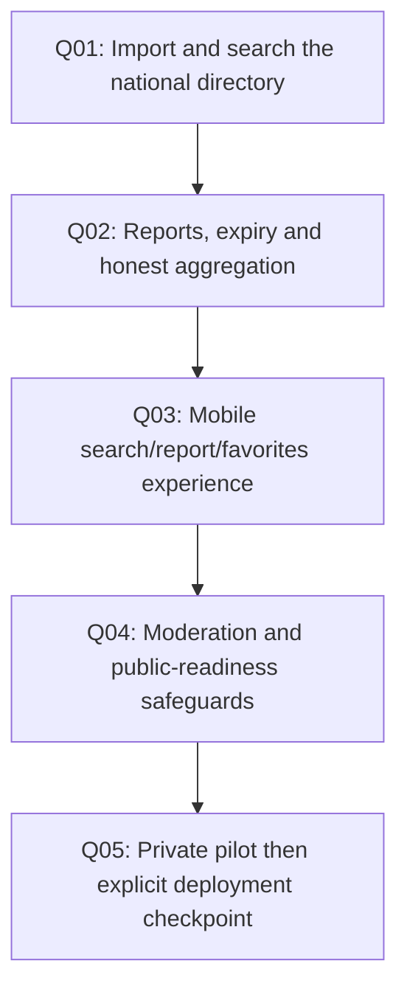

# Crous Queue — dependency map to MVP

Start with the first package. Finish its acceptance before advancing. Subsequent packages are proposed work, not simultaneously claimed tasks. Report results and friction through Foundry at every checkpoint.

## Q01 — Import and search the national directory

Dependencies: none. Owner: implementing agent.

Implement:

Build strict importer from 26 declared feeds using the retained normalized snapshot and small XML fixtures. Save provenance, separate source fields and safe display fields.

Acceptance:

972-row observed snapshot imports idempotently; Cuvier/Châtelet IDs resolve; coordinate duplicates remain distinct; malformed/failed region preserves last-good data; hostile CDATA is not executable.

Checkpoint record: changed files and commit/dirty-state hash, exact commands and results, screenshots where applicable, known gaps, decision and proposed next package. Do not call it complete while required acceptance is red.

## Q02 — Reports, expiry and honest aggregation

Dependencies: Q01. Owner: implementing agent.

Implement:

Implement signed device session, request idempotency, estimate/completed split, throttles and exact 15-minute clock semantics. Unit test with injected UTC clock.

Acceptance:

Empty != zero; 15min report excluded; latest same-device replaces older; conflicting 0/40 values show conflict; completed wait does not masquerade as live estimate; retries do not add votes.

Checkpoint record: changed files and commit/dirty-state hash, exact commands and results, screenshots where applicable, known gaps, decision and proposed next package. Do not call it complete while required acceptance is red.

## Q03 — Mobile search/report/favorites experience

Dependencies: Q02. Owner: implementing agent.

Implement:

Build venue card/search and one-hand report form. Display counts, freshness and source limitations, with client expiry and offline read-only/error behavior.

Acceptance:

At 390px user finds Cuvier and submits 10min in <=3 interactions after venue selection; browser clock advance expires estimate; offline retry cannot duplicate it; no location permission required.

Checkpoint record: changed files and commit/dirty-state hash, exact commands and results, screenshots where applicable, known gaps, decision and proposed next package. Do not call it complete while required acceptance is red.

## Q04 — Moderation and public-readiness safeguards

Dependencies: Q03. Owner: implementing agent.

Implement:

Implement admin auth, hide/flag history, server limits, retention command, metrics without PII, backup/restore, and plain-language privacy page.

Acceptance:

Two simultaneous duplicate writes create one report; hidden report removed from aggregates immediately; deletion job honors cutoffs; server logs contain no session token/precise location.

Checkpoint record: changed files and commit/dirty-state hash, exact commands and results, screenshots where applicable, known gaps, decision and proposed next package. Do not call it complete while required acceptance is red.

## Q05 — Private pilot then explicit deployment checkpoint

Dependencies: Q04. Owner: implementing agent.

Implement:

Exercise Cuvier/Châtelet with synthetic data in demo and ordinary voluntary reports only when available. Prepare rollout config and cost/teardown document; do not seed public live feeds with invented waits.

Acceptance:

National directory works with unknown waits everywhere; real and demo data are separate; launch authorization explicit. Measure fresh-report coverage and returning contributors, not just installs.

Checkpoint record: changed files and commit/dirty-state hash, exact commands and results, screenshots where applicable, known gaps, decision and proposed next package. Do not call it complete while required acceptance is red.

## First chunk to execute now

Q01: Build strict importer from 26 declared feeds using the retained normalized snapshot and small XML fixtures. Save provenance, separate source fields and safe display fields.

## Branches after MVP

Five lunch days at Cuvier/Châtelet after a usable app exists: freshness coverage at fixed checks, estimate versus own completed wait (clearly different measures), contribution friction and repeat contributors. No mandatory interviews before implementation. National venue availability does not imply national live data. If reporting stays sparse, keep honest unknowns and test distribution rather than adding fictitious prediction.

If a technical prerequisite fails, submit evidence and a narrow alternative through Foundry; continue independent tasks. Do not replace the product with an easier unrelated one or hide a missing capability behind synthetic demo output.
